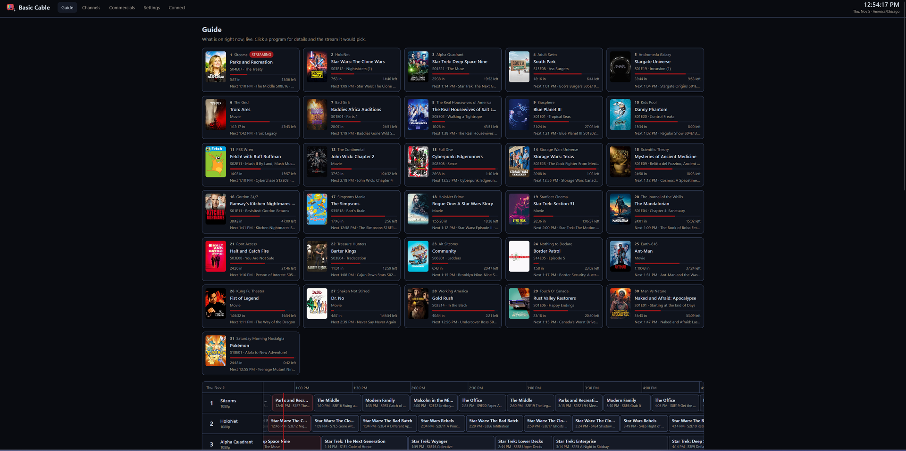

<p align="center"></p>

# Basic Cable

Basic Cable turns shows and movies from Stremio into scheduled live TV channels. It runs in a container on your network and plays everything through the Stremio stream addons you've set up with a debrid service. It doesn't provide any media of its own (see the [disclaimer](#disclaimer)).

Each channel has a guide that runs on the real clock. Open a channel in Stremio and you join whatever is on, at the point it has reached: if *Modern Family* started 10 minutes ago, you start 10 minutes in.



## Features

- **Auto-fill pools**: add shows, movies or wildcards to a channel, and any time not covered by a time slot is filled from the pool. Shows play in episode order and pick up where they left off.
- **Time slots**: weekly blocks like "Weeknights 8:00 PM: Modern Family" or "Weekends 10 PM–1 AM: `Batman*` movies".
- **Wildcards**: `Star Trek*` adds The Next Generation, Voyager, Deep Space Nine, Discovery and the rest. Untick any match you don't want. New matching titles are added daily.
- **Subtitles**: English text subtitles become a selectable track, and image subtitles (Blu-ray PGS) are burned in. See [Subtitles](#subtitles).
- **Resolution per channel**: each channel has a target resolution and falls back to the nearest lower one, or the nearest higher one if you prefer. Only cached, direct debrid links are used. CAM, telesync and TVSYNC releases are skipped, and so are Dolby Vision-only files (optional) and anything matching the channel's skip words.
- **Wrong-show filtering**: addons sometimes return a similarly named show's files, such as *Star Wars: The Clone Wars* episodes for the 2003 *Star Wars: Clone Wars*. Basic Cable reads the title from each file name and drops releases that name a different show or movie it plays. Shows that share a name (*Doctor Who* 2005 and 2023) are told apart by the year in the release name. Releases it can't read, or that name something it doesn't play, are kept.
- **Preferred and blocked words**: a release with a preferred word in its name wins over everything else, resolution included. The default is `Superfan`, so The Office plays its extended episodes when an addon has them. Blocked words rule a release out on every channel; the defaults are `YIFY` and `YTS`, whose small re-encodes look soft on a big screen.
- **HDR**: *Prefer HDR* picks HDR10, HDR10+ or HLG over SDR, and *Prefer HDR10* puts HDR10/HDR10+ first. Neither one gives up resolution for HDR. With *Avoid Dolby Vision-only releases* ticked, a Dolby Vision file without an HDR10 layer doesn't count as HDR.
- **No-repeat window**: a channel won't air the same episode or movie again within 3 days, or whatever window you set. Each channel keeps 90 days of history, shown in the channel editor. If every choice is a repeat (a small pool), the one shown longest ago plays. Episodes that were cut short don't count.
- **Commercial breaks**: upload your own old commercials, bumpers and promos into bundles ("2000s Kids", "Adult Swim Bumps") and play 1–3 of them between programs. See [Commercials](#commercials).
- **"Up next" box**: optionally, during a program's last minute, a box in the corner shows the next two programs. See [Up next box](#up-next-box).
- **Streams picked in advance**: about 10 minutes before a program starts, its file is chosen and checked. Tuning in then only has to start the video. See [Fast tune-in](#fast-tune-in).
- **Backup and restore**: export channels, pools, wildcards, slots and each show's progress to one JSON file and import it elsewhere. See [Backup and restore](#backup-and-restore).
- **One stream per device**: each viewer IP watches one channel at a time, and the channel you switch away from stops. See [Stream cap](#stream-cap).
- **MCP server**: Claude, or any MCP client, can create and edit channels from requests like "make a Saturday-morning cartoons channel". See [MCP server](#mcp-server).
- **Web guide**: a clock, a now-playing view with progress bars and an EPG grid. Click a program to see which stream it would use.
- **IPTV output**: an M3U playlist and an XMLTV guide for VLC, Kodi, TiviMate, Jellyfin, Plex and similar apps.

## How it works

```
Stremio ──/stream/tv/basiccable:3──▶ Basic Cable ──▶ live HLS URL for channel 3
Stremio ──/live/3/index.m3u8───────▶ Basic Cable
                                       │ guide says: Modern Family S01E05, 10:00 in
                                       │ ask your Stremio stream addons
                                       │ rank: cached + direct link + target resolution
                                       ▼
                         ffmpeg -ss 600 -readrate 1 -i <debrid link> -c:v copy → HLS
```

Stremio's stream protocol has no way to say "start 10 minutes in". Basic Cable does the playout itself instead. Each channel runs one ffmpeg process. It reads the debrid file in real time from the scheduled position, copies the video, converts the audio to stereo AAC (by default) and writes a rolling HLS playlist. When a program ends, the next one is appended to the same playlist after a discontinuity marker. Everyone watching a channel shares that process and its one debrid connection. ffmpeg stops a minute after the last viewer leaves.

Much of the playout code is there to cope with debrid connections that slow down or drop:

- Read-ahead: each watched channel reads up to 2 minutes ahead of real time, but a segment only appears in the playlist when the schedule reaches it. Viewers stay in step with the guide, and a slow read uses up the server's buffer instead of theirs. In testing, a 60-second stall didn't interrupt playback: the buffer went from 119 to 94 seconds and was full again 15 seconds later. If a debrid host stops responding, ffmpeg reconnects after 20 seconds, and if no video arrives for 45 seconds the stream restarts from the last second delivered.
- Player buffer: the playlist runs 30 seconds ahead of live, counted from when the channel's first video exists, which gives a player about 30 seconds of its own buffer when it tunes in. At 18 seconds, players stalled a few times in their first minutes. The playlist lists about 60 seconds of video, which lets a player that stalls carry on where it was instead of erroring and jumping ahead.
- Between programs: if the next program's stream isn't ready yet, short "Up next" filler segments keep the playlist moving. Without them, players give up and return to their menus.
- Timestamps: each program's timestamps continue from the previous one, because some players ignore discontinuity markers (mpv, which Stremio desktop uses) and would otherwise see time jump backwards.
- Dropped links: playback resumes from the last second delivered and the end of the episode is trimmed instead. Because ffmpeg sometimes exits normally when a link dies, an episode only counts as finished if it reached the end of the file or of its slot.
- Sparse keyframes: copied video can only be cut at keyframes. Most files have one at least every 10 seconds, but some rips go 30 seconds or more without one, and segments that long make players stall. A segment longer than 12 seconds is discarded before it's published, and the rest of the program is re-encoded with a keyframe every 2 seconds (one to two CPU cores at 1080p). HDR video stays copied, since re-encoding would flatten its colours.
- Bad files: a file that fails right away is retried once with the video re-encoded. If that fails, the next release is tried, and if every release fails, another episode takes its place. If nothing works, a "couldn't play" slate is shown and Basic Cable keeps retrying.

Failed segment and playlist requests are logged as warnings, which makes player problems easy to find in the logs.

## Quick start

Images for amd64 and arm64 are published to `ghcr.io/titleos/basiccable`. Download the compose file, set `TZ` and `ADMIN_PASSWORD` in it, and start it:

```bash
curl -O https://raw.githubusercontent.com/TitleOS/BasicCable/main/docker-compose.yml
docker compose up -d
```

Or with `docker run`:

```bash
docker run -d --name basiccable --restart unless-stopped -p 7000:7000 \
  -e TZ=America/New_York -e ADMIN_PASSWORD=change-me \
  -v basiccable-data:/data --tmpfs /tmp/basiccable-hls:size=2g \
  ghcr.io/titleos/basiccable:latest
```

`:latest` follows the main branch. Release tags are also published as versions (`:0.2.0`, `:0.2`) if you'd rather pin one.

Open `http://<server-ip>:7000` from a device on your network.

1. Under **Settings → Debrid stream addons**, paste the manifest URL of each Stremio stream addon you've set up with your debrid service, one per line. Most of these addons put your debrid key in the manifest URL, so treat the URLs like passwords. **Test addons** checks that each one returns cached links.
2. Under **Channels → New channel**, give the channel a name and a target resolution, then add shows, movies or a wildcard to its auto-fill pool. Add time slots if you want fixed programming.
3. On the **Connect** page, copy the manifest URL. In Stremio, go to **Addons**, paste it into the search box and click **Install**. (The one-click install button only appears for https addresses, because Stremio treats `stremio://` links as https.) The channels appear under **Discover → TV → Basic Cable**.

> Open the web UI through the server's LAN address, not `localhost`, before copying the install link: Stremio on your TV needs an address it can reach. Behind a reverse proxy, set **Public URL** in Settings or `BASE_URL` in compose.

### Stremio clients and https

The desktop, Android and Android TV apps accept plain `http://` LAN addresses. **Stremio Web** (web.stremio.com) only loads `https` addons. To use Basic Cable there, put it behind a reverse proxy with a certificate (Caddy, Nginx Proxy Manager, Tailscale Serve) and set the public URL.

## Configuration

| Variable | Default | |
|---|---|---|
| `TZ` | `UTC` in the compose file, otherwise the system's | Timezone for the guide and time slots, as an IANA name such as `America/New_York` or `Europe/London`. Change it to yours: with UTC, a "weeknights 8 PM" slot airs at 8 PM UTC. It can also be changed in Settings. |
| `PORT` | `7000` | |
| `BASE_URL` | *(from request)* | Public address used in stream and playlist URLs. Without `ADMIN_PASSWORD`, the web UI only works through an IP address, a single-word host name, a home-network name (`.lan`, `.local`, `.home.arpa`...) or this address. |
| `ADMIN_PASSWORD` | *(none)* | Protects the web UI, its API and the MCP server with HTTP basic auth (any user name). Set one; see [Security](#security). The addon, live and playlist endpoints stay open because Stremio and IPTV apps can't log in. |
| `DATA_DIR` | `/data` | SQLite database. |
| `HLS_DIR` | `/tmp/basiccable-hls` | Live segments and the read-ahead buffer. Put it on a tmpfs (RAM); see [Keeping segments in RAM](#keeping-segments-in-ram). |
| `READ_AHEAD_SECONDS` | `120` | How far ahead of real time each watched channel reads. `0` turns read-ahead off. |
| `READ_AHEAD_MB` | `300` | Per-channel cap on the read-ahead buffer. It also never uses more than a quarter of the free space in `HLS_DIR`, which limits how far ahead a 4K remux reads. |
| `GUIDE_HOURS` | `48` | How far ahead the guide is planned. |
| `IDLE_SECONDS` | `60` | How long a channel keeps running after its last viewer leaves. |
| `TRUST_PROXY` | *(off)* | Set to `1` behind your own reverse proxy to read viewer IPs from `X-Forwarded-For`, and the public address from `X-Forwarded-Host` and `X-Forwarded-Proto`. Otherwise every viewer appears to be the proxy. Leave it off when nothing sits in front of Basic Cable. |
| `SUBTITLE_BURN_PRESET` | `veryfast` | x264 preset for re-encoding (burned-in subtitles, the "Up next" box). Faster presets use less CPU and look worse. |

## Security

- Set `ADMIN_PASSWORD`. Without it, anyone who can reach the port can change channels and settings and read your stream addon URLs, which usually contain your debrid key. Basic Cable logs a warning at startup when it listens on all interfaces with no password.
- Some endpoints are always open, because Stremio and IPTV apps can't log in: the addon (`/manifest.json`, `/catalog`, `/meta`, `/stream`), the live streams (`/live`), `/direct`, `/playlist.m3u`, `/epg.xml` and channel art. Anyone who can reach them can watch your channels, using your debrid account.
- After 10 wrong passwords in 15 minutes, an IP address is refused for 15 minutes, right password or not. Behind a reverse proxy, set `TRUST_PROXY=1` so this applies per viewer and not to the proxy as a whole.
- The web UI's API and the MCP server refuse browser requests from pages Basic Cable didn't serve. Another website open in a browser on your network can't read or change anything. If a reverse proxy rewrites the `Host` header, set **Public URL** (or `BASE_URL`), or set `TRUST_PROXY=1` to use `X-Forwarded-Host`.
- Without a password, the web UI's API also only answers when you reach it by IP address, a single-word host name, a home-network name (`.lan`, `.local`, `.home.arpa`, `.internal`...) or the Public URL / `BASE_URL`. If you use another domain name on your network, set `BASE_URL` to it, or set a password.
- The Docker image runs Basic Cable as the unprivileged `node` user. It starts as root only long enough to give that user the data and segment folders, so volumes from older images keep working. To skip that step, run it with `--user 1000:1000` and make sure that user can write to `/data`.
- If you expose Basic Cable to the internet, put it behind a reverse proxy that adds TLS and its own access control (an allow-list, a VPN such as Tailscale, or an authenticating proxy), and keep `ADMIN_PASSWORD` set.
- Log lines keep only the host of any URL (`https://addon.example/…`). Logs can be pasted into a bug report without leaking addon URLs or debrid links.

## Scheduling details

A channel is planned from Cinemeta runtimes (one value per series, such as "21 min", rounded up per channel). Real files run shorter or longer, and the guide is corrected as their lengths become known. It shows what's actually on, to the minute, rather than neat :00 and :30 times:

- About 10 minutes before a program airs, its file is prepared and its slot is set to the file's exact length, plus the commercial break if the channel has one. Everything after it moves to match. This happens whether or not anyone is watching.
- When a program starts at a different time than the guide says, that program and everything after it move to the real start time. Differences of a few seconds are ignored.
- Nothing is replayed: after a program ends, the channel only moves on to programs later in the guide.
- Moving the guide changes times, never what plays or in what order. Long episodes get their full length: double-length premieres and finales, two-parters and extended cuts, up to three times the series' runtime or the runtime plus 90 minutes, whichever is more. A file that clearly isn't one episode keeps its planned slot: under half the runtime (a bad length header) or over that limit (a whole season in one file). A program that starts before it was prepared is sized to its file when it starts, so it isn't cut off either.

Time slots:

- Moving the guide never moves a weekly time slot. The programs before it move, and the last one runs up to the slot's start. If a program would run into a slot, the rest of that block is replanned.
- Auto-fill programs never run into a slot. Leftover time at the end of a block goes to the previous program if it's under 10 minutes; otherwise something from the pool that fits fills it. An episode that has to be cut short airs again next time instead of being skipped.
- Episode progress is kept per channel and per show, and shared between the pool and slots. Specials (season 0) and unreleased episodes are skipped.

The no-repeat window:

- The planner skips anything that aired in full, or is already planned, within the channel's window, counting both the history and the guide ahead. In-order shows move past such an episode; random ones pick another. The window runs from start time to start time. Editing the window rebuilds that channel's guide.
- The guide is planned two days ahead and then moves earlier as programs turn out shorter than planned, which can pull an episode a few hours inside the window. To catch that, each program's real time is checked again when its stream is prepared, about 10 minutes before it airs. If it would now be a rerun, the channel's usual rules put something else in its place.
- A channel with less programming than its window can't avoid reruns (11 films is about 25 hours, against a 3-day window). It plays whatever aired longest ago, and everything comes round before anything repeats. The channel editor's Recently shown panel, and the MCP tool `basiccable_recently_shown`, tell you when that's happening. Add titles or shorten the window to change it.

Editing a channel replans everything after the program that's on now. The program on air keeps playing.

## Subtitles

When the file has embedded subtitles, Basic Cable picks one track per program:

1. An English SDH track (flagged hearing-impaired, or titled SDH/CC), if there is one.
2. Otherwise, the first English or unlabelled track.

Forced-only tracks, which only carry the foreign-language lines, are skipped.

Many releases have no subtitles at all, small x265 WEBRips especially. When the best-ranked release that plays has none, Basic Cable probes up to two more releases ranked level with it (same resolution, HDR, preferred words, and cached on your debrid service) and uses the first one with a subtitle track tagged English. An unlabelled track doesn't count for this. If none of them has one, the first release plays without subtitles.

How the track reaches the player depends on its format and the channel's **English subtitles** setting:

| | Selectable track, or burned in for image subs *(default)* | Selectable track only | Off |
|---|---|---|---|
| Text (SRT, ASS, WebVTT) | Caption track, on by default | Caption track, on by default | None |
| Image (Blu-ray PGS, DVD) | Burned into the video | Skipped; a text track is used if there is one | None |

- Caption tracks use almost no CPU: ffmpeg converts them to WebVTT alongside the video. The channel's `index.m3u8` becomes an HLS master playlist with an "English" track marked as default, which viewers can turn off. The playlist also declares that the video has no closed captions; otherwise ExoPlayer-based players (Stremio on Android TV) add an empty "Unknown" caption track. Captions embedded in the video stream itself (CEA-608) aren't offered.
- Burning in means re-encoding the video with x264, which keeps a few CPU cores busy per channel for real 1080p content. 4K sources are scaled to 1080p first. If a channel can't keep up, lower `SUBTITLE_BURN_PRESET` (for example to `superfast` or `ultrafast`), or set the channel to **Selectable track only** so it never re-encodes.
- Subtitle files next to the video in a torrent can't be used, because debrid links point at the video file alone.
- Subtitles need ffmpeg 7.x. With a subtitle stream included, ffmpeg 8.0's real-time pacing drops to about half speed, so on 8.x Basic Cable plays without subtitles and logs a warning. The Docker image ships 7.1.

## Commercials

The **Commercials** page holds your clip library, grouped into bundles such as *2000s Kids*, *90s Saturday Morning* or *Adult Swim Bumps*. Create a bundle, then drop video files onto it (mp4, mkv, webm, mov, avi, ts, mpg and others, up to 5 minutes each).

Each clip is converted once in the background and then copied straight into the stream at playback:

- Video: H.264, at most 1080p, square pixels, deinterlaced if it's an old TV rip.
- Audio: stereo AAC with normalized loudness, so commercials aren't louder than the show. Clips without sound get a silent track.

Breaks are set per channel in the channel editor's **Commercials** panel: how many clips per break (off, 1, 2 or 3), and which bundles to use. With no bundles ticked, the channel uses all of them.

How breaks fit into the guide:

- Every program's slot includes time for the break after it: clips per break times the average clip length of the chosen bundles, rounded up with the program's slot length. A 24-minute episode with two 1-minute spots gets a 30-minute slot instead of 25.
- A break plays after a program ends and stops at the next program's scheduled start. If the chosen clips are shorter than the time set aside, the next program starts right after them and the guide moves to match.
- Clips are picked at random from the chosen bundles, among those that fit the time left, avoiding the last dozen played on that channel.
- Breaks don't appear in the guide, Recently shown or XMLTV. Tuning in during a break joins the break, and the next program follows.

**Bundles as zip files.** **Export .zip** downloads a bundle's original clips as one zip, to share or to import on another install. **Import bundle (.zip)** turns a zip of clips into a bundle named after the zip, or adds them to the bundle named in the box. Folders inside the zip are flattened, so you can zip a whole folder of clips. Non-video files and macOS/Windows metadata files are skipped, and the import reports what it left out. Clips already in the bundle aren't added again, so importing the same zip twice does nothing new. A zip containing paths that climb out of its folder (`../`) is refused. Limits: 1 GB per clip (`COMMERCIAL_MAX_MB`) and 20 GB per zip (`COMMERCIAL_ZIP_MAX_MB`). The API equivalents are `GET /api/commercials/bundles/<name>/export` and `POST /api/commercials/import?name=<bundle>` with the zip as the request body.

**Loading many clips.** Clips live under `commercials/<bundle>/` in the data volume. Copy files into those folders (or bind-mount a host folder on `/data/commercials`) and press **Scan for new files**. Files deleted from a folder drop out of the library on the next scan.

**Backups and MCP.** Backups include each channel's commercial settings but not the clips, so copy the `commercials` folder yourself when moving installs. Over MCP, `basiccable_list_commercials` shows the library, and `basiccable_update_channel` takes `commercials_per_break` and `commercial_bundles`.

## Up next box

With **Show "Up next" in the last minute** ticked on a channel, a semi-transparent box appears in the bottom-right corner of the picture for the last minute of each program. It lists the next program and the one after it, with their start times:

```
UP NEXT · 8:30 PM
Modern Family S02E03 · The Kiss
THEN · 9:00 PM
The Office S04E01 · Fun Run
```

The box is drawn into the video, and every player shows it. The trade-offs:

- The last minute is re-encoded with x264 (at `SUBTITLE_BURN_PRESET`, at most 1080p), which takes one to two CPU cores per watched channel for that minute. The rest of the program is still copied.
- 60 seconds before the end, the copied stream stops and the re-encoded one takes over, the same way playback resumes after a dropped link. Most players carry on without a pause; some stutter briefly.
- HDR programs get no box, since re-encoding them would flatten their colours.
- The box shows the guide as it is when the last minute starts. Programs that are already being re-encoded (burned-in subtitles, sparse keyframes) get the box without the extra hand-over.

## Backup and restore

**Settings → Backup & restore** downloads a `basiccable-backup-<date>.json` file containing:

- every channel and its options,
- the auto-fill pools, including wildcards and any matches you unticked,
- time slots,
- each show's progress.

Settings are left out unless you tick **Include settings**, because they contain your debrid addon URLs and keys.

To restore, choose the file on another install (or the same one) and click **Import**. Imported channels are added alongside the existing ones; a channel whose number is taken gets the next free number. **Replace existing channels** deletes the current channels first, and **Also restore settings from the file** applies the backup's settings if it has them.

Guides are rebuilt in the background after an import. A file with problems is rejected before anything changes, with a message naming the channel at fault.

From the API: `GET /api/backup` (add `?settings=1` to include settings) and `POST /api/restore` with `{"backup": <file contents>, "replace": false, "includeSettings": false}`.

## Keeping segments in RAM

Each watched channel keeps its read-ahead buffer and its last minute of published video in `HLS_DIR`: around 250 MB per channel at 1080p, and up to about 1 GB for a 4K remux. This data is rewritten constantly, so keep it in RAM:

- docker compose: the included `docker-compose.yml` mounts a 2 GB tmpfs at `/tmp/basiccable-hls`, the default `HLS_DIR`. Leave `HLS_DIR` unset.
- docker run: add `--tmpfs /tmp/basiccable-hls:size=2g`.
- Portainer, single container: the container form has no tmpfs option, but every container has a RAM-backed `/dev/shm`. Under **Advanced container settings → Runtime & Resources**, set **Shared memory size** to 2048 MB, then set the environment variable `HLS_DIR=/dev/shm/basiccable-hls`.
- Portainer stack: paste the compose file under **Stacks → Add stack** to get the tmpfs mount.

Size it for the number of channels you'll watch at once. If it fills up, the read-ahead shrinks rather than failing.

## Fast tune-in

Opening a channel would otherwise wait for every stream addon to answer and then check the chosen file, which can take several seconds with slow addons. To avoid that, once a minute Basic Cable prepares the current program and anything starting within the next **Prepare streams ahead** minutes (Settings, default 10) on every enabled channel:

1. It asks the addons for streams and ranks them.
2. It checks that the top file is reachable and real, not a debrid "downloading" placeholder.
3. It keeps that choice for up to 2 hours.

Opening the channel then starts ffmpeg right away, and the program's log line says `stream was prepared ahead`. In testing with addons that took 5 seconds to answer, tune-in went from 6.2 s to 1.0 s.

Preparing a stream also reveals the file's real length, and the program's guide slot is set to match it. A Superfan episode gets its full extended length instead of being cut off, and a 21-minute file in a 25-minute slot hands the extra 4 minutes to the next program. Only programs that haven't started are changed. See [Scheduling details](#scheduling-details).

### Episodes with nothing playable

Sometimes no addon has a usable copy: every result is uncached, torrent-only or filtered out. Basic Cable then puts something else in that spot by the channel's usual rules. In-order channels play the next episode and continue the show from there, random channels pick another random episode, and pools with several titles may move on to a different show.

An upcoming program is replaced before it airs. A program already on air is cut off and the replacement starts immediately. The replacement is checked right away as well, and a run of missing episodes is skipped in one go. Tuning in does the same, even with preparing turned off, so you get the next playable episode instead of a "couldn't play" screen.

A skipped episode isn't scheduled again for 6 hours. After that it gets another chance, since debrid caches change.

In these cases Basic Cable treats the problem as an outage, skips nothing, and tries again later:

- no addon answers at all;
- an addon fails (including answering with only a notice, such as a rate-limit message) and the others have nothing usable;
- everything on the channel failed recently. The channel keeps its guide and retries rather than skipping through its whole lineup.

Only programs that haven't started are checked ahead of time; a program on air is never cut off by this check.

Lookups are spaced 3–30 seconds apart at random to keep a batch of channels from hitting your addons all at once and tripping their rate limits. Tuning in doesn't wait for this: a program that isn't prepared yet is looked up immediately.

Preparing costs one addon lookup and one file check per program, even when nobody is watching. Set **Prepare streams ahead** to 0 to turn it off.

## Stream cap

With **One stream per viewer IP** on (Settings, on by default), each device watches one channel at a time:

- Opening a channel releases the one that device was watching.
- If nobody else is watching that channel, it stops immediately, along with its ffmpeg process and debrid connection, instead of running for another minute.
- A player that keeps requesting the channel you left gets an error instead of restarting it.
- Other devices aren't affected: two TVs can watch two channels, or the same one.

The cap only covers live channel streams. **Start over** links go straight to your debrid service and never pass through Basic Cable.

Behind a reverse proxy, set `TRUST_PROXY=1`. Otherwise every viewer shares the proxy's IP and counts as one device.

## MCP server

Basic Cable has an [MCP](https://modelcontextprotocol.io) server at `/mcp` (Streamable HTTP). An assistant such as Claude Code can manage it from requests like these:

> Make a channel called Saturday Cartoons with Animaniacs, Pinky and the Brain and Batman: The Animated Series, 720p, and put Pokémon on Saturdays 8 to 10am.
>
> Set every channel to skip REMUX releases.
>
> What's on channel 4, and why is it only 480p?
>
> Skip whatever's on Adult Swim.

To connect Claude Code:

```bash
claude mcp add --transport http basiccable http://<server>:7000/mcp
```

If you set `ADMIN_PASSWORD`, add `--header "Authorization: Bearer <password>"` (Basic auth works too). This repo's `.mcp.json` registers the server for Claude Code sessions opened in the repo, reading the address from `BASICCABLE_MCP_URL` and the password from `BASICCABLE_TOKEN` if they're set.

| Area | Tools |
|---|---|
| Look around | `basiccable_list_channels`, `basiccable_get_channel`, `basiccable_get_guide`, `basiccable_whats_on`, `basiccable_recently_shown`, `basiccable_list_commercials`, `basiccable_server_status` |
| Channels | `basiccable_create_channel` (settings, pool and slots in one call), `basiccable_update_channel`, `basiccable_bulk_update_channels`, `basiccable_delete_channel` |
| Pool & slots | `basiccable_add_to_pool`, `basiccable_remove_from_pool`, `basiccable_set_wildcard_exclusions`, `basiccable_add_slots`, `basiccable_remove_slots` |
| Titles | `basiccable_search_titles`, `basiccable_preview_wildcard` |
| Playback | `basiccable_skip_current`, `basiccable_check_streams`, `basiccable_rebuild_guide` |
| Addons & settings | `basiccable_get_settings` (addon keys hidden unless asked), `basiccable_add_stream_addon`, `basiccable_remove_stream_addon`, `basiccable_test_stream_addons`, `basiccable_update_settings` |
| Backups | `basiccable_export_backup`, `basiccable_import_backup` |

The tools accept:

- channels by number or name ("4", "adult swim");
- titles by name, optionally with `movie:` / `show:` or a year ("Heat (1995)"), by IMDb id, or as a wildcard ("Star Trek*");
- days like "weeknights", "mon-fri", "sat, sun";
- times and lengths like "8pm", "20:00", "1h30m".

Every change reports what each title matched, along with the closest alternatives. A name with no close match is refused with suggestions rather than guessed. Browser requests from other websites are rejected.

## Outputs

| URL | |
|---|---|
| `/manifest.json` | Stremio addon |
| `/playlist.m3u` | M3U playlist for IPTV players |
| `/epg.xml` | XMLTV guide |
| `/live/<channel>/index.m3u8` | A channel's live stream |

The Stremio stream list also has a **Start over** entry, which redirects to the debrid link for the current program, from the beginning. Use it if a player has trouble with the live HLS stream.

## Known limitations

- Video is copied as-is to keep CPU use near zero, except where noted above (burned-in subtitles, sparse keyframes, the "Up next" box). The device you watch on has to decode whatever the release uses, such as HEVC or 10-bit. To avoid a codec, add it to the channel's skip words, for example `HEVC, x265`.
- Joining mid-program starts at the nearest keyframe before the scheduled position, usually within a couple of seconds.
- Uncached torrents are ignored, since live TV can't wait for a download. Configuring several addons gives the best cache coverage.

## Development

```bash
npm install
npm start          # http://localhost:7000, data in ./data
npm test
```

To run your own build in Docker, replace the `image:` line in `docker-compose.yml` with `build: .` and run `docker compose up -d --build`.

`test/mock-addon.js` is a fake debrid stream addon that serves one local video file with HTTP Range support, for testing playback without a debrid account:

```bash
SAMPLE_FILE=/path/to/video.mkv node test/mock-addon.js   # MOCK_DELAY_MS=5000 makes it answer slowly, like a real addon
```

Then add `http://localhost:7099/manifest.json` as a stream addon.

`test/mcp-smoke.js` runs every MCP tool against a running server. It creates a test channel, deletes it afterwards, and needs internet access for Cinemeta:

```bash
MCP_URL=http://localhost:7000/mcp ADDON_URL=http://localhost:7099/manifest.json node test/mcp-smoke.js
```

Requires Node 22.13 or newer (for the built-in `node:sqlite`) and ffmpeg 6.1 or newer on the PATH. Older ffmpeg versions work but tune in more slowly. For subtitles, use ffmpeg 7.x; see [Subtitles](#subtitles).

GitHub Actions runs the tests on pull requests and other branches (`.github/workflows/test.yml`). On pushes to main and on `v*` tags, `.github/workflows/docker.yml` runs the tests, builds the image for amd64 and arm64, scans it with Trivy (a fixable CRITICAL finding stops the publish) and pushes it to GHCR. `.forgejo/workflows/docker-build-push.yml` is the same pipeline for a self-hosted Forgejo, pushing `:<short sha>` and `:latest` to the registry set in the `REGISTRY` repository variable.

## Disclaimer

Basic Cable does not host, index, provide or distribute media files of any kind. It schedules and plays whatever the Stremio stream addons and services you configure return. You are responsible for which addons and services you use and how you use them, and for having the rights to stream the files they provide. Basic Cable is not affiliated with Stremio or any addon or debrid service.

## License

[Mozilla Public License 2.0](LICENSE), with the Commons Clause: you can use, change and share Basic Cable, but not sell it or paid services built mainly on it. Created by **TitleOS**.
